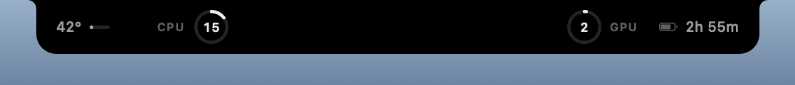
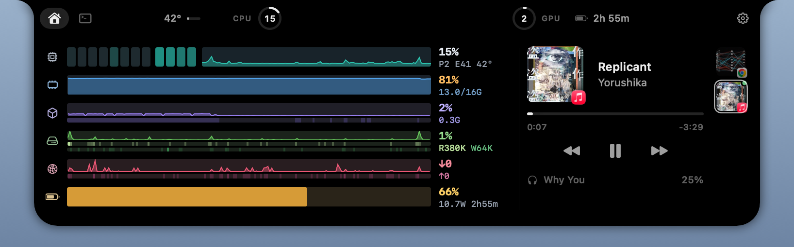
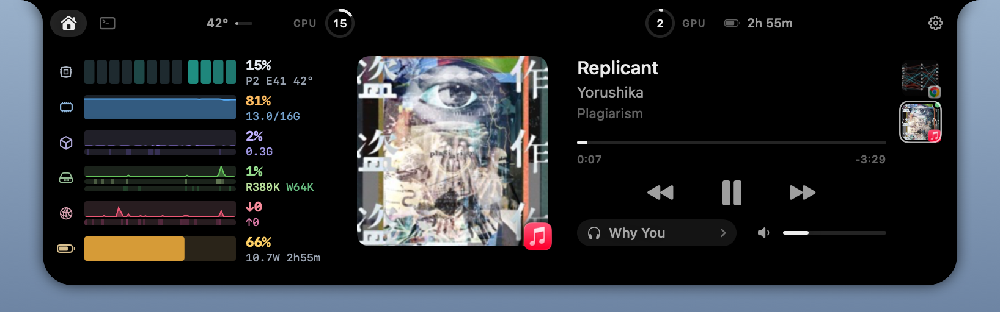
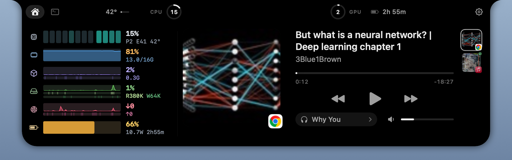

# Bubble 🫧

A tiny, pure-black system monitor that wraps around your MacBook's camera, and opens into
performance stats, a music player and (optionally) a quick terminal.



Collapsed: CPU core temperature and CPU load on the left of the camera, GPU load and battery time on the right.

## Install

Requires macOS 14+ and the Xcode Command Line Tools (`xcode-select --install`).

```bash
git clone https://github.com/Vasiniks/bubble.git
cd bubble
./build.sh install
```

This builds Bubble, copies it to `/Applications` and launches it. Run the same command again to update.

To start Bubble automatically, open Preferences (the gear in the open notch, or right-click) and turn on **Launch at login**.

**Uninstall:** right-click Bubble → **Quit Bubble**, then delete `/Applications/Bubble.app`.

## Use

| Action | Result |
| --- | --- |
| Hover the notch, or click it | Open (the half you came in on pops up) |
| Two-finger swipe down / up on it | Open / close |
| Move the pointer away, click elsewhere, or **esc** | Close |
| **⌃⌥⌘B** | Open / close |
| Right-click (collapsed) | Open Bubble, Terminal, Preferences…, Quit Bubble |

The notch springs open with a little bounce and settles closed, with a trackpad tick when the
pointer arrives (turn off hover-to-open or haptics in Preferences).

### Home

Performance on the left, music on the right, in one view. Whichever side the pointer is on
pops up: move toward the left edge for the full monitor, toward the right edge for the large
player, and the other side shrinks to a compact summary.



Pointer on the left: the full monitor, with music shrunk to a mini player.

**Performance** is six live graphs in the style of [Glance](https://github.com/Vasiniks/glance),
each a strip with its readout beside it:

| Row | Graph | Readout |
| --- | --- | --- |
| CPU | A tile per core in one row (performance, then efficiency), plus load history | Load, P/E averages, core temperature |
| RAM | Memory in use | Used %, used / total |
| GPU | Load, with GPU memory as a thin band | Load, memory in use |
| Disk | Busy time, with read and write as thin bands | Busy %, read / write per second |
| Network | Download, with upload as a thin band | ↓ / ↑ per second |
| Battery | Charge, as a plain bar | Charge, watts, time left |

Rates are scaled to their recent peak. Popped up, the graphs are wider and reach further back
(2 pt per sample, up to 4 minutes at the open refresh of one per second).



Pointer on the right: the large player, with Music and a YouTube tab in the source stack.

**Music**, compact: a mini player with artwork, controls and the current output. Popped up:
large artwork, track details, a seekable progress bar, playback controls, volume, and an output
picker for every audio device (speakers, AirPods, AirPlay, displays). Now Playing works with
any app (Music, Spotify, browsers); click the artwork to bring the player forward.

When more than one app has media (say Music and a YouTube tab), a stack of up to four blocks
sits at the far right, like Control Center's list: each shows its artwork with the app's icon,
a green dot while it plays, and a ring around the one in the player.

- **Hover** a block and the player fades over to that source (its art, title and position). It
  stays there after you move on, until the notch closes or another app starts playing.
- **Click** a block to go to it: for Chrome, Brave, Edge, Vivaldi or Safari, Bubble switches to
  the tab that's playing it (matched by title; macOS asks once per browser whether Bubble may
  control it). Other apps just come forward.



The YouTube video picked from the stack, while Music keeps playing.

The playback buttons and seek bar act on whichever source is in the player, so two things can
play at once (say, start Music while a YouTube video keeps going). macOS only lets Control Center
send commands to an app that isn't Now Playing, so for those Bubble asks the app itself:

- **Music, TV and Spotify** take the commands directly (macOS asks once whether Bubble may
  control each).
- **Browser tabs** (Chrome, Brave, Edge, Vivaldi, Safari) are played, paused, skipped or seeked
  through the page, which needs the browser's **Allow JavaScript from Apple Events** turned on
  (Chrome: View → Developer; Safari: Develop menu). Without it, the buttons take you to the tab.
- Other apps' buttons rest; click the artwork to go there.

### Terminal

Its own tab, and optional: turn **Quick terminal** off in Preferences and the tab and its
shell are gone. A one-line prompt into a persistent `zsh` login shell, so `cd`, `export` and your PATH carry
over between commands. **↩** runs, **↑/↓** walk history, **⌃C** stops the running command,
**⌃L** or **⌘K** clears. It runs commands rather than emulating a terminal, so full-screen
programs like `vim` or `top` won't work; it's for the quick stuff.

## How it reads things

**CPU core temperature** comes straight from the SMC. Every core's thermal sensor is published
as three consecutive keys (e.g. `Tp00`/`Tp01`/`Tp02`); the middle one is the calibrated core
reading. Bubble finds these at launch by binary-searching the SMC's sorted key index (no
per-model tables), then each reading is about ten 4-byte reads: ~2 ms, ~0.13 ms of CPU. Idle
clusters are power-gated and their sensors drop to near zero, so those are skipped; a sensor
that covers a whole cluster counts once per core, so every core weighs the same in the average.

**Now Playing**: macOS only reports it to Apple-signed processes, so Bubble ships a 75 KB
helper library (`Sources/MediaBridge`) and runs it inside `/usr/bin/perl`, only while the notch
is open, plus 20 seconds. It exits on its own when Bubble closes it or quits.

**Controlling other sources** goes through `osascript`, started only when you press a button
for a source that isn't Now Playing, or click to go to a tab: AppleScript for Music, TV and
Spotify, and the page's video or audio element for a browser tab.

Everything else uses native APIs: Mach host statistics (CPU, per-core load, memory), IOKit (GPU,
power, battery, disk I/O), CoreAudio (outputs and volume), `proc_pid_rusage` (processes) and
`sysctl` (network, swap, memory pressure).

## Lightweight

Measured on an M2 Pro (macOS 26), release build, 40 seconds per state. CPU is Bubble's own CPU
time per second of wall time; memory is its physical footprint.

| State | CPU | Memory | Helpers |
| --- | --- | --- | --- |
| Closed, 2 s refresh (default) | ~2 ms/s (0.2%) | 13 MB | none |
| Closed, 1 s refresh | ~4 ms/s (0.4%) | 13 MB | none |
| Open on Home (performance or music) | ~6–9 ms/s (0.6–0.9%) | 32–39 MB | perl, 6 MB, idle |
| Open on the terminal | ~4 ms/s (0.4%) | 29 MB | zsh, 1.6 MB, idle |

After the notch has been opened once, Bubble stays around 30 MB, since SwiftUI keeps the views
it built. No dependencies and no Accessibility permission; macOS asks for Automation (controlling
another app) only the first time you control a source or go to its tab. The app is 1.6 MB, plus
the 75 KB media bridge.

- One low-priority timer: every 2 seconds while closed (the Refresh setting), every second while
  open, paused while the display sleeps. Each closed sample takes about 0.2 ms of CPU; most of the
  remaining cost is redrawing the two rings.
- Registry values (GPU, power, disks) are read straight from CoreFoundation, and the list of disk
  drivers is looked up once a minute rather than every sample.
- The graphed readings are kept while closed, so the graphs are full when you open it; nothing
  is drawn until you do. Temperature is read every 5 seconds while closed, per-core load only
  while open, and the whole notch redraws in one pass per sample.
- The music helper and audio listeners run only while Home is open, plus 20 seconds.
- `osascript` runs only for a click or button press on a source that isn't Now Playing, and
  exits when it's done.
- The terminal's shell starts the first time you open the terminal, and never if it's off.
- Battery and audio-device changes are pushed by macOS, never polled.

A metric that can't be read shows `—`.

## Development

```bash
./build.sh        # build Bubble.app in the repo
./build.sh run    # build and launch it from the repo
```

`swift build` alone builds the app without the media helper; the music side then shows Now
Playing as unavailable.

The open/close feel follows [boring.notch](https://github.com/TheBoredTeam/boring.notch)
(hover delay, spring timings, corner radii); the code here is Bubble's own.

## License

MIT
